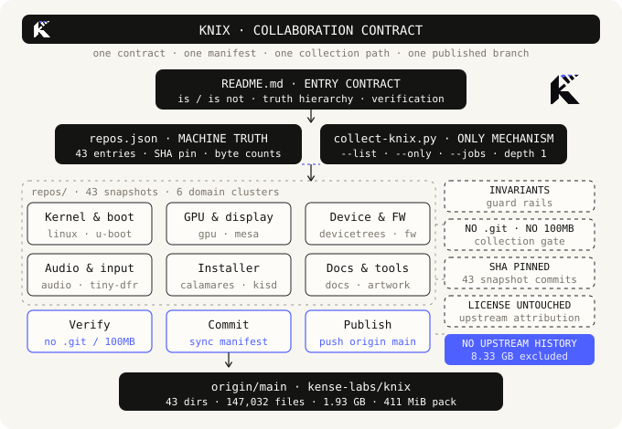

# knix

43 个公开仓库默认分支的源码快照 monorepo，SHA 锁定，单一 `main` 发布面。

[First principles](#first-principles) · [Architecture](#architecture) · [Run backends](#run-backends) · [Invariants](#invariants) · [Operations](#operations) · [Do not](#do-not) · [Known Limitations](#known-limitations-and-deferred-work) · [Scale](#scale-and-status) · [Roadmap](ROADMAP.md)

> [!NOTE]
> 机器真源：[repos.json](repos.json)。

> [!TIP]
> 提交前执行 `python3 scripts/verify-knix.py`。

## First principles

| Knix 是 | Knix 不是 |
| --- | --- |
| 43 份同一时刻的默认分支源码快照 | 43 个可独立 clone / build 的活仓库 |
| 以 `repos.json` 为机器真源的归档基线 | 上游的 fork、镜像或新上游 |
| 一次采集、一次 SHA 锁定、一条 `main` 发布线 | 带上游历史、tag、其他分支的完整镜像 |
| 人与 AI agent 共同遵守的协作契约 | 介绍文案 |
| 品牌统一的内部参考副本 | 对上游代码的重新许可或重新署名 |

**Truth hierarchy**

1. `repos.json`
2. `scripts/collect-knix.py`
3. `repos/`
4. `README.md` · `docs/knix-architecture.*` · `docs/brand/`
5. `origin/main` · `git@github.com:kense-labs/knix.git`

## Architecture

<p align="center">
  
</p>

[SVG](docs/knix-architecture.svg) · [PNG](docs/knix-architecture.png)

1. **Collect** — `git clone --depth 1 --single-branch --no-tags`，剥离 `.git`，替换 `repos/<name>`。
2. **Pin** — 写入 43 个 `snapshot_sha` 与逐仓文件数、字节数。
3. **Verify** — `python3 scripts/verify-knix.py`。
4. **Publish** — 单次提交推送 `origin/main`。

## Run backends

| 后端 | 内核基线 | 设备语义 |
| --- | --- | --- |
| `native-apple` | `knix.config` · `CONFIG_ARCH_APPLE` | `m1n1` · `u-boot` · `devicetrees` |
| `vm-virt` | `virt.config` | 标准 virtio · QEMU |

`platform/CONTRACT.md` 拥有产品边界；后端是启动方式，不是能力来源。`platform/host-adapters/` 为非规范资产，可选、默认关闭、不进入镜像。

| 规则 | 内容 |
| --- | --- |
| 单一身份 | 一个 `knix.img`、一个 `origin/main`、一套品牌 |
| 单一真源 | `repos.json` 的 43 条、SHA 与统计不随后端改变 |
| 能力 | 宿主只提供标准 virtio；私有扩展可关闭且有降级路径 |
| 归属 | 认证、界面、输入与设备语义留在 Guest |

`platform/identity/` 拥有名称、版本、内核基线、包集、会话与品牌字节；`platform/image/build.sh` 是镜像构建入口，`platform/backends/vm-virt/boot-native.sh` 是启动入口。镜像本身是派生产物，不入库。

## Invariants

| # | 不变量 |
| --- | --- |
| I1 | `repos/` 恰好 43 个目录，与 `repos.json` 的 `name` 一一对应 |
| I2 | 每条 `snapshot_sha` 为 40 位十六进制 |
| I3 | `repos/` 内无嵌套 `.git` |
| I4 | 无超过 95 MB 的单文件 |
| I5 | `snapshot_files` / `snapshot_bytes` / `totals` 与磁盘一致 |
| I6 | 全仓无上游品牌与代号字面（含二进制元数据） |
| I7 | 内核 UAPI、设备树 compatible 与仓库名标识符统一为 Knix 命名 |
| I8 | `docs/brand/` 官方 mark 字节与品牌契约一致 |
| I9 | 单一 `main` 分支，无 tag，无启用 submodule 或嵌套 `.git` |
| I10 | `README.md` 无上游品牌字面与代号残留 |
| I11 | `repos/artwork/logos/` 全部资产由 `docs/brand/` 官方 mark 派生 |
| I12 | `repos/` 内无悬空符号链接 |
| I13 | `README.md` 无自指元叙述与解释性说明 |
| I14 | 运行后端不越产品边界；宿主适配器不进入镜像与发布清单 |
| I15 | 身份、镜像清单与品牌哈希与全部构建输入一致 |

## Operations

```bash
python3 scripts/verify-knix.py

python3 scripts/collect-knix.py --list
python3 scripts/collect-knix.py
python3 scripts/collect-knix.py --only linux,m1n1
python3 scripts/collect-knix.py --jobs 4

platform/image/build.sh --check
platform/image/build.sh --build
platform/image/sign.sh

# inside the arm64 Linux build guest; scripts are streamed over ssh
platform/image/build-kernel.sh --check
platform/image/build-kernel.sh --apply
platform/image/build-rootfs.sh --check
platform/image/build-rootfs.sh --apply
platform/image/assemble-native.sh     # requires root

# launch paths on the host
platform/backends/vm-virt/boot-dev.sh
platform/backends/vm-virt/boot-native.sh

python3 scripts/verify-knix.py && git add -A && git commit -m "chore: refresh snapshots" && git push origin main
```

**回滚**：`git revert <commit>` 或 `git reset --hard <commit>`。

## Do not

- 手工改动 `repos/` 而不回写 `repos.json`。
- 把上游 `.git` 历史、tag 或其他分支塞回快照。
- `git submodule add` 或递归拉取 submodule。
- 改动 `repos/` 内的 `LICENSE` / `COPYING`。
- 回退或混用旧标识符。
- 手工编辑 `docs/brand/` 的 PNG，或调整 logo 尺寸与配色。
- 绕过 `make-knix-logos.py` 直接改写 `artwork/logos` 的派生资产。
- 运行 `repos/artwork/logos/Makefile` 重新生成 logo。
- 改写统计数字或采集时间。
- 把 `knix.img` 或其他构建产物提交进仓。
- 让宿主适配器参与构建、启动、认证或镜像。
- 把宿主状态当作 knix 的硬件语义。
- 新增发布分支、tag 或第二个 origin。

## Known Limitations and Deferred Work

- 仅默认分支采集时刻状态；不含历史、tag、其他分支。
- 上游 `.gitmodules` 文本原样保留；submodule 未启用，`artwork`、`m1n1` 已作为独立仓库收录。
- `source_url` / `clone_url` 指向 `github.com/Knix/...`；`--list` 拒绝上游命名漂移。
- `docs/brand/` 官方 SVG 保留 `aria-label="KStudio"`；`artwork/logos` 上游 Makefile 不作为生成路径。
- 统计为采集时刻值。
- 内核 UAPI 与设备树 compatible 已重命名；`repos/linux` 已在 arm64 Linux guest 内编译出 7.2.15 内核，其余快照不保证与上游 ABI 对齐或可编译。
- 第三方插画、横幅与启动图保留原始构图；`artwork/logos/` 已由官方 mark 派生。
- `repos/mesa-nightly/mesa` 为未拉取的 submodule，用户态图形栈源码不在快照内。
- `vm-virt` 已跑通 QEMU/HVF 启动、单镜像构建与冷启复验；`native-apple` 仍只有契约定义。
- 内核在 Linux guest 内原生编译；macOS 宿主只提供标准 virtio，构建工具、源码副本与产物都在仓外构建盘中。
- `knix.img` 是唯一发布产物：`build.sh --build` 在 guest 内把原生 rootfs、自编译 7.2.15 内核、770 个模块、身份与品牌装进新建空白 GPT 盘，seed 只作一次性包源与 helper 引导。receipt 记录镜像 sha256 与内核、rootfs、身份、品牌、`virt.config` 的全部输入摘要。
- `knix.img` 没有 EFI 系统分区或 bootloader，靠 `boot-native.sh` 的 `-kernel` 直启；P2 补自有 initramfs / EFI bootloader。
- `knix-native.img` 是 P0 阶段的开发验证盘，已退役，不是发布面；当前启动入口只指向 `knix.img`。
- 构建盘的 `out/vmlinux.o` 曾被早期 VM 强停截断；`build-kernel.sh` 现用 ELF section header 检测并清空重建，已产出 770 个 `.ko` 与 `modules.dep`。启动所需的 virtio、ext4、PL011 与 devtmpfs 仍全部编入内核，直启不依赖 initrd。
- `wireless-regdb` 默认指向发行版签名的 `regulatory.db`，与内核内置的上游密钥不匹配；`assemble-native.sh` 把 alternative 切到 `-upstream` 变体，冷启日志已无 `cfg80211` 告警。
- Wayland / sway 在 headless 验证环境只校验包集与会话文件；virtio-gpu 实际渲染未验证。
- CI 只校验仓内输入与契约；seed qcow2、QEMU/HVF 启动与镜像构建在本机执行。
- Deferred：能力协商清单、宿主适配器参考实现、统计与清单生成器入库、定期重采调度、增量 diff 报告、GPU 图形路径。

## Scale and status

| 指标 | 数值 |
| --- | --- |
| 仓库数 | 43 |
| 文件数 | 147,032 |
| 源码总体积 | 1.94 GB（2,081,410,824 字节） |
| 上游完整历史体积 | 8.33 GB |
| 默认分支 | main 28 · master 9 · 其余 6 |
| 已归档 / fork | 14 / 9 |
| 单文件最大值 | < 100 MB |
| 采集时间 | 2026-11-11T02:27:42+00:00 |
| 发布面 | `origin/main` · `git@github.com:kense-labs/knix.git` |
| 首次推送包体积 | 411 MiB |

## Layout

```
knix/
├── README.md
├── ROADMAP.md
├── repos.json
├── .github/workflows/                # knix-contract.yml
├── scripts/
│   ├── collect-knix.py
│   ├── make-knix-architecture.py
│   ├── make-knix-logos.py
│   └── verify-knix.py
├── platform/
│   ├── CONTRACT.md
│   ├── contract.json
│   ├── identity/                     # identity.json · os-release · packages.json · session.json
│   ├── image/                        # build.sh · build-kernel.sh · build-rootfs.sh · assemble-native.sh · inject-identity.sh · sign.sh · RELEASE.md
│   ├── backends/
│   │   ├── native-apple/
│   │   └── vm-virt/                  # boot-dev.sh · boot-native.sh
│   └── host-adapters/                # non-normative
├── docs/
│   ├── knix-architecture.svg
│   ├── knix-architecture.png
│   └── brand/
└── repos/                           # 43 dirs
```

完整清单与逐仓元数据：[repos.json](repos.json)。字段：`name`、`source_url`、`clone_url`、`default_branch`、`snapshot_sha`、`snapshot_at`、`description`、`archived`、`fork`、`license`、`upstream_pushed_at`、`upstream_size_kb`、`local_path`、`snapshot_files`、`snapshot_bytes`。

## License and attribution

各仓库源码版权归各自上游项目及贡献者所有，`LICENSE` / `COPYING` 随快照完整保留；许可标识见 `repos.json` 的 `license` 字段。本仓库不改变也不重新授权上游代码的许可。

`repos/artwork/logos/` 的图形由 `docs/brand/` 官方资产派生；上游 `LICENSE` 文本原样保留。
